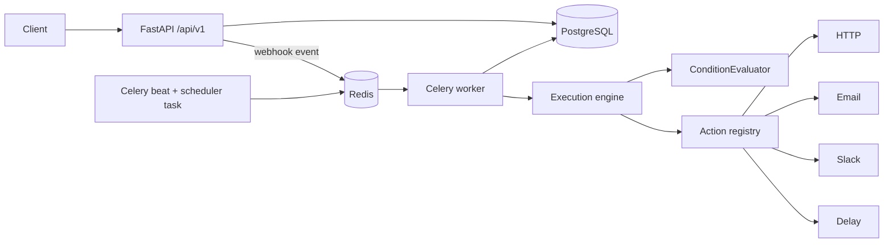
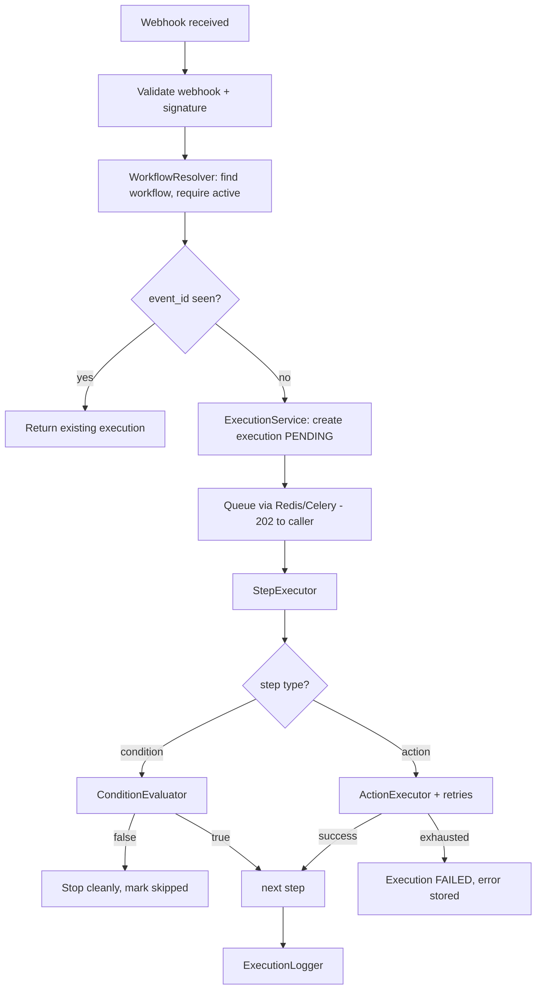

# Workflow Automation Platform

A production-quality, Zapier-style **workflow automation engine** built with Python and FastAPI:
webhook/scheduled triggers → condition evaluation → pluggable actions → async execution with
retries, idempotency, and full execution history.

## Features

- **JWT auth** — register, login, access + refresh tokens, logout with token revocation,
  bcrypt password hashing, per-user ownership on every resource.
- **Workflow CRUD** — `draft → active → inactive → archived`, versioning, ordered steps,
  activate/deactivate endpoints. Only `active` workflows execute.
- **Triggers** — webhook (`POST /api/v1/webhooks/{token}`, HMAC signature optional,
  `X-Event-Id` idempotency) and schedule (cron via Celery Beat + polling task).
- **Condition engine** — `== != > >= < <= contains not_contains starts_with ends_with
  in not_in is_empty is_not_empty` with safe dotted-path resolution (`order.customer.email`).
  No `eval()`, ever.
- **Pluggable actions** — `http_request`, `send_email` (mock provider for local dev),
  `send_slack_message` (webhook), `delay`. New actions register in one line without
  touching the engine. `{{field.path}}` templating against the trigger payload.
- **Async execution** — API acknowledges webhooks with `202`, Celery + Redis runs the
  workflow; sync fallback if the broker is unreachable; eager mode for tests.
- **Reliability** — per-step `max_attempts` / `retry_delay_seconds`, retryable vs terminal
  error classification, `(workflow_id, event_id)` idempotency, SSRF guard on user URLs,
  rate limiting on auth/webhook endpoints, timeouts everywhere.
- **Observability** — per-execution and per-step records (attempts, timing, input/output,
  errors) plus a structured execution log; contextual logging with
  `workflow_id / execution_id / step_id`; secrets never logged.
- **Security** — integration credentials encrypted at rest (Fernet), preview-only API
  responses, consistent error envelope, no stack traces leaked.

## Tech Stack

Python 3.12 · FastAPI · PostgreSQL · SQLAlchemy 2.x · Alembic · Pydantic v2 · JWT ·
Redis · Celery (+Beat) · httpx · Pytest · Docker / Docker Compose · OpenAPI/Swagger.

## Architecture



### Workflow execution flow



### Database design

`users` → `workflows` → `workflow_triggers` / `workflow_steps` /
`workflow_conditions` (queryable mirror of condition steps) / `webhooks` /
`scheduled_jobs` → `workflow_executions` → `step_executions` / `execution_logs`;
`integrations` (encrypted credentials) and `revoked_tokens` supporting tables.
Key indexes: `user_id`, `workflow_id`, `execution_id`, `status`, `created_at`,
`event_id`, plus unique `(workflow_id, event_id)` and unique webhook tokens.

## API Documentation

Full interactive docs at `/docs` (Swagger) and `/redoc`. Main groups:

```text
POST /api/v1/auth/register | POST /api/v1/auth/login | POST /api/v1/auth/refresh
GET  /api/v1/auth/me       | POST /api/v1/auth/logout
POST /api/v1/workflows     | GET /api/v1/workflows | GET/PUT/DELETE /api/v1/workflows/{id}
POST /api/v1/workflows/{id}/activate | POST /api/v1/workflows/{id}/deactivate
POST /api/v1/webhooks/{token}        (public ingestion)
GET  /api/v1/webhooks                (manage) | POST /api/v1/webhooks/{id}/rotate
GET  /api/v1/executions | GET /api/v1/executions/{id}
GET  /api/v1/workflows/{id}/executions
GET/POST /api/v1/integrations | GET/PUT/DELETE /api/v1/integrations/{id}
POST /api/v1/actions/http | GET /api/v1/actions | GET /api/v1/users/me | GET /health
```

Errors share one envelope (HTTP status varies, internals never leak):

```json
{ "success": false, "message": "Workflow not found", "error": { "code": "WORKFLOW_NOT_FOUND" } }
```

## Setup Instructions

```bash
python -m venv .venv && source .venv/bin/activate
pip install -r requirements.txt
cp .env.example .env   # adjust SECRET_KEY, DATABASE_URL, REDIS_URL
alembic upgrade head   # or: tables auto-create is NOT enabled; migrations are the path
uvicorn app.main:app --reload
```

### Environment variables

See `.env.example`. Important ones:

```text
SECRET_KEY, CREDENTIALS_ENCRYPTION_KEY
DATABASE_URL            (default sqlite:///./workflow.db; compose uses postgres)
REDIS_URL / CELERY_BROKER_URL / CELERY_RESULT_BACKEND
CELERY_TASK_ALWAYS_EAGER (true = run inline, used by tests)
EMAIL_PROVIDER=mock | smtp (+ SMTP_*), SCHEDULER_ENABLED, TIMEZONE
```

### Docker instructions

```bash
docker compose up -d
# frontend:3000 · api:8000 · postgres:5432 · redis:6379 · celery-worker · celery-beat
```

Development source is bind-mounted into the containers: Next.js hot-reloads
frontend edits, Uvicorn reloads backend edits, and Celery worker/beat restart
when Python files change. No application image rebuild is needed for code edits.
Frontend dependencies are installed into a named volume at startup; after
changing `frontend/package.json` or its lockfile, restart it with
`docker compose restart frontend` so dependencies are reinstalled. Database
migration changes still require `docker compose exec api alembic upgrade head`.

Set `BETTER_AUTH_SECRET` and `TOKEN_ENCRYPTION_KEY` in the root `.env` to replace
the development-only frontend key defaults before exposing the app beyond local
development.

On the first startup, Compose waits for the API migration and health check, then
loads the demo user, integrations, workflows, and sample executions. Sign in
with `admin@admin.com` / `Admin@123`. The seed completion marker persists with
the Compose volumes, so restarting the stack does not add duplicate demo data;
`docker compose down -v` removes it along with the database.

## Running Tests

```bash
pytest -q
```

42 tests, no external services: SQLite + `CELERY_TASK_ALWAYS_EAGER=true` +
`mock://` action doubles. Covers auth, workflow CRUD/ownership, every condition
operator, successful/multi-step/condition-stop/retry-exhaustion executions,
webhook valid/invalid/inactive/duplicate/signature, integrations (encryption +
no leakage), and SSRF blocking.

## Example Workflow

High-value order alert: webhook → `order.amount > 5000` → email + Slack.

```bash
# 1. register
TOKEN=$(curl -s localhost:8000/api/v1/auth/register \
  -H 'Content-Type: application/json' \
  -d '{"email":"ops@shop.com","password":"password123"}' | python -c 'import sys,json;print(json.load(sys.stdin)["tokens"]["access_token"])')

# 2. create workflow
curl -s localhost:8000/api/v1/workflows -H "Authorization: Bearer $TOKEN" \
  -H 'Content-Type: application/json' -d '{
  "name": "High value order",
  "trigger": {"type": "webhook", "config": {}},
  "steps": [
    {"type": "condition", "config": {"field": "order.amount", "operator": ">", "value": 5000}},
    {"type": "action", "action": "send_email",
     "config": {"to": "admin@example.com", "subject": "Big order {{order.id}}",
                "body": "Amount: {{order.amount}}"}},
    {"type": "action", "action": "send_slack_message",
     "config": {"webhook_url": "mock://slack/alerts", "text": "Big order {{order.id}}"}}
  ]}'

# 3. activate, then fire the webhook (use token from GET /api/v1/webhooks)
curl -s -X POST localhost:8000/api/v1/workflows/<id>/activate -H "Authorization: Bearer $TOKEN"
curl -s -X POST localhost:8000/api/v1/webhooks/<token> \
  -H 'Content-Type: application/json' -H 'X-Event-Id: order-1001' \
  -d '{"order": {"id": "A-1001", "amount": 7500}}'   # -> 202 {"execution_id": ...}

# 4. inspect
curl -s localhost:8000/api/v1/executions/<execution_id> -H "Authorization: Bearer $TOKEN"
```

Re-sending with the same `X-Event-Id` returns the original execution
(`"deduplicated": true`) instead of running twice.

## Failure / Retry Behavior

Each action step declares `max_attempts` (1–10) and `retry_delay_seconds`.
Network errors, timeouts, HTTP 429/5xx are **retryable**; 4xx, validation and
unknown-action errors are **terminal**. Every attempt is logged; on exhaustion the
step is `failed`, downstream steps are skipped, and the execution is `failed`
with the error stored and queryable. A failing condition stops the workflow
cleanly (`success`, first step `skipped`) since no action was required.

## Security Considerations

- bcrypt passwords; short-lived access JWT + revocable refresh JWT; logout revokes both.
- Ownership checks on every object; integration secrets Fernet-encrypted, preview-only
  responses, redacted in logs.
- SSRF guard resolves user URLs and blocks private/loopback/link-local/metadata targets
  (`mock://` allowed for tests); only `http(s)` schemes; request timeouts enforced.
- Rate limits on auth + webhook ingestion; HMAC webhook signatures when a secret is set.
- No `eval()` in the condition engine; Pydantic validation on all input.

## Future Improvements

- Async SQLAlchemy + Postgres `LISTEN/NOTIFY` for lower-latency dispatch.
- Cron scheduling with timezone-aware next-run materialization and a UI.
- Parallel step branches / fan-out, JSON-schema step config validation per action.
- Per-workflow concurrency limits, dead-letter queue, execution replay from any step.
- OpenTelemetry tracing across API → worker → actions.
